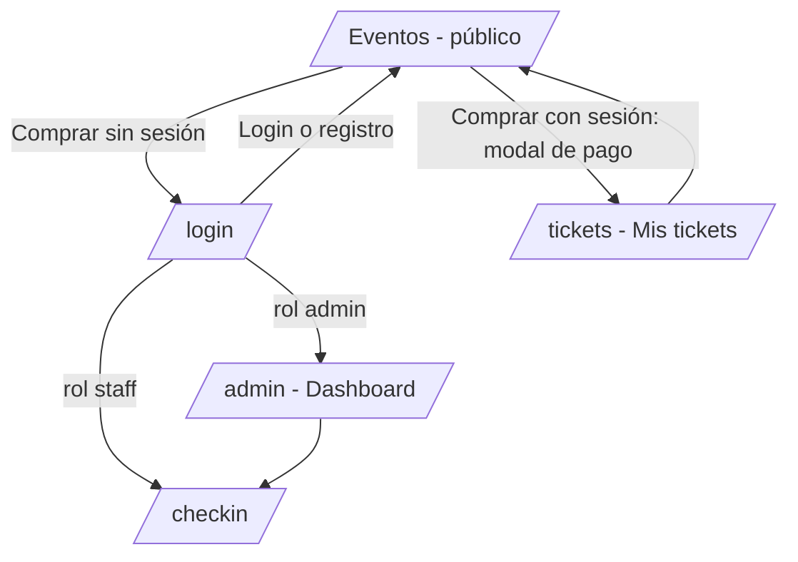

# Mapa de navegación

| Ruta | Acceso | Contenido |
|---|---|---|
| `/` | Público | Catálogo de eventos, disponibilidad, modal de compra y pago |
| `/login` | Público | Inicio de sesión / registro |
| `/tickets` | Autenticado | Tickets con QR y estado |
| `/checkin` | staff, admin | Validación de tickets en puerta |
| `/admin` | admin | Aforo en vivo (5 s) y creación de eventos |

Rutas protegidas redirigen a `/login` (sin sesión) o a `/` (sin permisos).
